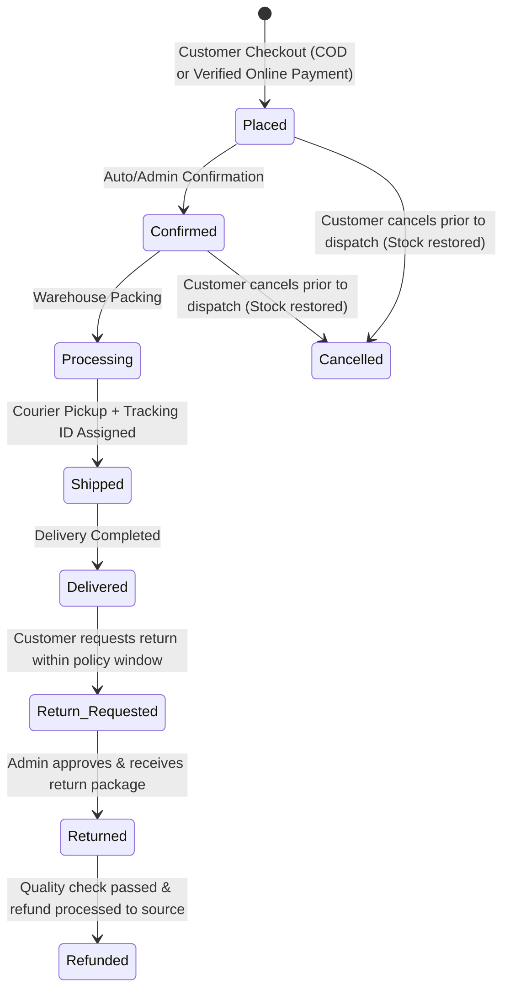

# 👑 Shagun Shine Cosmetics — Client Handover & Production Operations Manual

> **Document Version:** 1.0.0 (Production Release)  
> **Brand Name:** Shagun Shine Cosmetics  
> **Target Market:** India (D2C Luxury Beauty & Cosmetics)  
> **Prepared For:** Client / Business Owner & Operations Team  

---

## 📋 Executive Launch Readiness Status Matrix

| Subsystem | Readiness Status | Operational Description |
| :--- | :---: | :--- |
| **Customer Storefront** | ✅ **READY** | Luxury responsive UI (Mobile + Desktop), Category filters, Live search suggestions, Product detail, Wishlist, Bag, Dynamic SEO, and Static Policy pages. |
| **Admin Console & RBAC** | ✅ **READY** | Dedicated admin panel with role-based authorization (`super_admin`, `product_manager`, `order_manager`, `inventory_manager`, `customer_support`, `marketing_manager`, `reports_viewer`). |
| **Indian GST Tax Engine** | ✅ **READY** | Automated B2C GST computation: Intra-state (CGST 9% + SGST 9%) vs Inter-state (IGST 18%), HSN `330499`, and sequential invoice number generator. |
| **Payment Gateway** | 🟡 **CONFIG** | Digital Payment Gateway HMAC-SHA256 signature verification & Webhook idempotency implemented. Unified digital checkout (UPI, Cards, NetBanking). |
| **Shipping & Logistics** | 🟡 **CONFIG** | 6-digit Indian PIN serviceability engine, ₹999 free shipping threshold, and tracking workflow. Ready for Delhivery/Shiprocket API plug-in. |
| **Inventory & Concurrency** | ✅ **READY** | Atomic inventory transactions with `inventory_logs` ledger preventing negative stock and overselling. |
| **Returns & Refunds** | ✅ **READY** | Customer return request flow, admin moderation approval/rejection, and gateway refund triggers. |
| **Security & Auditing** | ✅ **READY** | `helmet` HTTP headers, `express-rate-limit`, bcrypt password hashing, sensitive cost price masking, and tamper-evident `audit_logs`. |
| **Demo Data Purge Tool** | ✅ **READY** | One-click safe purge mechanism in Admin Settings to wipe test orders and demo customers prior to official marketing launch. |

---

## 🔐 Administrator Access
 
> [!IMPORTANT]
> Administrator accounts are managed securely via environment variables or the Staff & Roles interface. No default credentials are included in production distribution packages.

---

## 💳 Payment Gateway Setup

The system supports zero sensitive card data storage compliance. All payments are verified on the server side using cryptographically secure HMAC-SHA256 signatures.

### Configuring Digital Payment Gateway:
1. Log in to the Admin Console as Super Admin (`/admin`).
2. Navigate to **Settings & Launch** (`/admin/settings`) → **Payment Gateway** tab.
3. Configure your **Payment Key / API Key**, **Payment Secret Key**, and **Webhook Verification Secret**.
4. Configure your webhook endpoint in your Payment Gateway Developer Dashboard:
   - **Payment Webhook URL:** `https://your-domain.com/api/webhooks/incoming/payment-gateway`
   - **Active Events:** `payment.captured`, `payment.failed`, `order.paid`.
5. Click **Save Payment Settings**.

---

## 🧾 Indian GST & Taxation Configuration

- **HSN Code:** `330499` (Beauty or make-up preparations and preparations for the care of the skin).
- **Default GST Rate:** `18.0%` (Inclusive in retail prices).
- **Tax Breakdown Logic:**
  - If Customer Shipping State matches Store Origin State (e.g. Haryana → Haryana):
    $$\text{CGST} = 9\%, \quad \text{SGST} = 9\%$$
  - If Customer Shipping State is outside Store Origin State (e.g. Haryana → Maharashtra):
    $$\text{IGST} = 18\%$$
  - Taxable Base Formula:
    $$\text{Taxable Amount} = \frac{\text{Retail Total}}{1 + (\text{GST Rate} / 100)}$$

---

## 🚚 Shipping & Pincode Serviceability

- **Pincode Engine:** Validates 6-digit Indian PIN codes against serviceable postal zones (Northern, Western, Southern, Eastern).
- **Free Shipping Threshold:** Defaults to orders of ₹999 and above. Orders below threshold incur a standard shipping fee of ₹99 (configurable in Admin Settings).
- **Order Tracking:** Customers can track orders at `/track` using either their Order Number (e.g. `SS-2026-100234`) or Courier AWB Tracking Number.

---

## 🔄 Order Lifecycle & Returns Workflow

---

## 🛡️ Security, RBAC & Audit Trails

1. **Sensitive Cost Price Isolation:**
   - `cost_price` is stored securely in the database for profit margin analysis but is **never** transmitted over public storefront APIs (`/api/products`).
2. **Audit Logging:**
   - Every price modification, stock adjustment, order status override, and configuration update is logged to `audit_logs` with timestamp, actor email, role, and IP address.
3. **HTTP Protection:**
   - Security headers enforced via `helmet` and rate limiting configured via `express-rate-limit` on login and registration endpoints.

---

## 🚀 Pre-Launch Checklist & Demo Purge

Before going live to real customers:

1. [ ] **Purge Demo Data:** Go to **Admin Console** → **Settings & Launch** → **Launch & Handover** tab. Click **Purge Demo Data for Live Launch** and type `PURGE DEMO DATA` to wipe test transactions and clear test audit logs.
2. [ ] **Update Legal & GSTIN Info:** Verify company name, registered address, GSTIN, and support phone number in **Settings & Launch** → **Store Profile** & **GST Settings**.
3. [ ] **Add Live Payment Keys:** Paste production Razorpay keys into **Payment Gateway**.
4. [ ] **Verify Product Inventory:** Confirm active stock quantities in **Inventory Manager**.
5. [ ] **Change Admin Passwords:** Update credentials for all administrator accounts.

---

*✨ Shagun Shine Cosmetics — Crafted with Royal Elegance for Modern Indian Luxury.*
